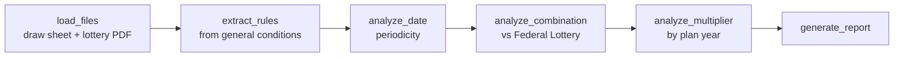

# Raffle Audit Agent

Audits the prize draws of capitalization bonds (a regulated Brazilian savings product with periodic raffles) against each product's general conditions, and produces a technical audit report with evidence.

**Stack:** Python · LangGraph · Azure OpenAI · pandas · SQLite · Streamlit · ReportLab (PDF)
**Role:** Lead developer: design and implementation

> Built at a large Brazilian insurer. The company is replaced by the fictional **Acme Seguros**, and every name, document and data point here is fictional. Code, prompts and UI are in Portuguese, written for Brazilian business teams.

## Problem

Each draw must follow the rules registered with the regulator (SUSEP) for that product: how often draws happen, how the winning combination is derived from the Federal Lottery results, and which prize multiplier applies in each year of the plan. Auditors checked this by hand, draw by draw.

## What I built

A six-step LangGraph pipeline:



- The general conditions are looked up by the product's SUSEP code in a local database.
- Lottery numbers are parsed from the official result PDF with regular expressions, not read by the model.
- Each check records whether the draw complies, and any divergence is documented with its evidence.
- Output is a technical report the audit team can file.

## Design decisions

- **One check per node:** each rule is verified on its own, so a failure points to exactly which rule broke.
- **Deterministic parsing first:** lottery numbers and dates are extracted and normalised in Python, so the model checks clean values against the rules instead of reading raw files.

## Run it

```bash
python -m venv .venv && .venv\Scripts\activate   # macOS/Linux: source .venv/bin/activate
pip install -r requirements.txt
cp .env.example .env                               # Azure OpenAI
streamlit run streamlit_app.py
```

The general-conditions database (`CG.db`) is not included; create one with your own sample product rules.

---
Part of my [AI engineering portfolio](https://github.com/lucasboliveirasipp).
